## Hi there 👋

- A reader and passionate programmer.
- Linux user for almost 3 years.
- I'm Currently working on my Rust library [Spell](https://github.com/VimYoung/Spell).
- I'm pursuing dual undergraduate degrees and figuring how stuff works in the remaining time.
- I'm currently learning data structures and algorithms in C.

## Contact me

- **Social Spaces:** I usually go by the name of VimYoung (mostly used in tech spaces) and Ramayen (general alias).
- **How to reach me:** You can contact me via my email at [ramayen [at] tutamail [dot] com](mailto:ramayen@tutamail.com) . For a quick chat, I am present in discord and matrix with username of "Ramayen".

  <picture>
    <source media="(prefers-color-scheme: dark)" srcset="assets/bonsai-dark.svg" />
    
  </picture>

